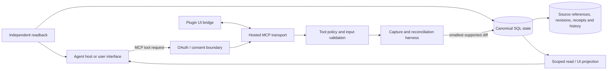

# Agent Infrastructure

Reliable agent work needs more than a model call. It needs a place to keep evidence, coordinate revisions, reject stale updates, make retries safe, and distinguish a historical receipt from the current state.

This showcase has two deliberately separate layers:

1. **Public continuity example:** a small, runnable offline Python package that demonstrates the durable-state controls.
2. **Broader private system:** a hosted MCP and SQL-backed plugin implementation that applies related controls to agent-assisted work capture, retrieval, correction and coordination. It is described here for architecture context; its code, configuration, records and integrations are not part of the public repository.

## The engineering problem

An agent can produce a plausible answer while operating on old context, duplicating an earlier action, or overwriting a later human correction. The infrastructure therefore treats work as versioned, source-backed state:

- retain the source reference that supports a saved item;
- read current state before a write, then reject a stale revision;
- use an idempotency key so an uncertain retry cannot create a second mutation;
- preserve immutable receipts while making fresh reads explicit;
- separate proposed work, authorized action and independently verified outcome.

## Implemented broader architecture



The broader system implements a Streamable HTTP MCP transport, a local MCP runtime, SQL persistence, versioned records, source references, capture/reconciliation flows, a plugin UI bridge, and hosted OAuth controls. Its hosted path validates OAuth authorization-code exchange with PKCE, restricts redirect/origin handling, uses expiring access and refresh grants, and keeps authorization data separate from workspace state.

The coordination harness is not a second agent that silently acts. It is the persistence and reconciliation layer: it retains stable IDs and evidence, applies the smallest valid change, protects manual edits, records receipt/history data, and requires a readback when a write is uncertain.

## Public code vs. broader system

| Capability | Public continuity example | Broader private system |
| --- | --- | --- |
| Offline durable state | SQLite record store with source quote hashes, revisions and receipts | Canonical SQL workspace state with source references, history and projections |
| Concurrency and retries | Expected-revision checks and idempotency-key replay protection | Versioned corrections, atomic batches, replay-safe writes and reconciliation checkpoints |
| Read semantics | `status` is a fresh read; mutation receipts are explicitly historical | Scoped workspace reads, UI projections and independent readback after uncertain writes |
| Review and authority | Distinct reviewer/owner labels as a small separation-of-duties example | Tool policy, user authority boundaries and explicit write/correction flows |
| MCP and UI | Not included | Local MCP runtime, hosted MCP transport and plugin UI bridge |
| Authentication | Not included | Hosted OAuth authorization-code flow with PKCE, bounded consent, expiring grants and refresh rotation |
| Operations | No network, install or service configuration | Isolated service configuration and SQL/auth stores; no public records or configuration in this showcase |

The public code does **not** implement MCP transport, OAuth, hosted service deployment, user authentication, provider integrations, model calls, background capture, or multi-user authorization. This document does not claim otherwise.

## Run the public continuity example

The public repository retains the small runnable package and its existing quickstart. From that repository's root:

```sh
mkdir -p /tmp/agent-work-continuity-demo
python3 -m agent_continuity.cli --db /tmp/agent-work-continuity-demo/state.sqlite record --input examples/record.json
python3 -m agent_continuity.cli --db /tmp/agent-work-continuity-demo/state.sqlite status routing-contract
python3 -m agent_continuity.cli --db /tmp/agent-work-continuity-demo/state.sqlite review --input examples/review.json
python3 -m agent_continuity.cli --db /tmp/agent-work-continuity-demo/state.sqlite recover
```

To run its existing tests:

```sh
python3 -m unittest discover -s tests -t . -v
```

See [the detailed continuity example](docs/continuity-example.md) for input schemas, receipts and diagnostic limits. Requires Python3.9+ and the standard library only.

The public example has eight offline tests covering source persistence, exact replay, changed-replay rejection, stale-write rejection, self-review rejection, source-hash rejection and database diagnostics and corrupt-file rejection.

## Boundaries

- Public inputs, actors, source references and work items are synthetic.
- The public package does not connect to an MCP host or any external service.
- The broader system is described as implemented architecture, not included source code or a production availability claim.
- No client workflows, real records, credentials, service configuration, provider endpoints or private implementation paths are included.
- A source hash establishes consistency of submitted evidence; it does not authenticate an external source by itself.
