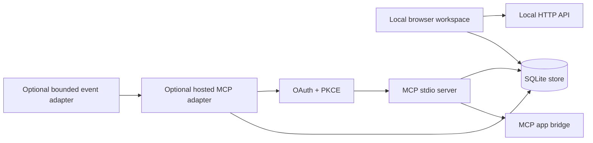

# Agent Infrastructure

An allowlisted export of a local agent-work system: SQLite persistence, a browser workspace, an MCP server with an app bridge, and an optional hosted MCP/OAuth adapter.

The exported code is source-identical to the reviewed implementation modules, except for one genericized plugin deep link. No database files, captured records, credentials, transcripts, caches, or deployment configuration are included.

## What runs here



- **Local workspace:** tasks, projects, records, tables, boards, priorities, source references, revisions and history live in SQLite.
- **MCP server:** exposes read, capture, correction, record, table, priority and scoped-workspace tools; it also serves the workspace and chat UI resources.
- **Coordination controls:** expected versions, atomic updates, stable IDs, immutable source references, idempotent request receipts and readback-oriented mutations.
- **Hosted adapter:** a Streamable HTTP MCP wrapper with authorization-code OAuth, PKCE verification, redirect/origin checks, expiring access grants and refresh rotation.
- **Event adapter:** a deliberately bounded experimental webhook implementation with signature verification, callback challenge checks, DNS-rebinding defenses and replay-safe delivery state.

## Run locally with a blank workspace

Requires Python 3.9+ and uses only the standard library for the local workspace and MCP server.

```sh
mkdir -p /tmp/agent-infrastructure-demo
python3 app.py --db /tmp/agent-infrastructure-demo/workspace.sqlite serve --port 18473
```

Open `http://127.0.0.1:18473`. This creates a new empty SQLite database at the path you supplied; it does not load any existing data.

To run the actual MCP server against a separate empty database:

```sh
python3 plugin/server.py --workspace . --db /tmp/agent-infrastructure-demo/workspace.sqlite
```

It speaks JSON-RPC over stdin/stdout. The included `plugin/mcp.json` is the actual portable launch contract for a plugin host; it points at the bundled runtime copy. Use the direct command above for a standalone local check.

## Tests

The local-store, MCP and browser-HTTP tests run with the standard library:

```sh
python3 -m unittest discover -s tests -p 'test_store.py' -v
python3 -m unittest discover -s tests -p 'test_priorities.py' -v
python3 -m unittest discover -s tests -p 'test_http.py' -v
python3 -m unittest discover -s tests -p 'test_plugin.py' -v
python3 -m unittest discover -s tests -p 'test_private_mcp.py' -v
```

The hosted OAuth/MCP and event tests require Flask and MarkupSafe. Install them only in an isolated local environment; the tests use temporary SQLite files and fictional configuration and do not contact a hosted service:

```sh
python3 -m pip install Flask MarkupSafe
python3 -m unittest discover -s tests -p 'test_hosted_mcp.py' -v
python3 -m unittest discover -s tests -p 'test_mcp_events.py' -v
```

## Export boundary

Included source is limited to the local store/UI, MCP transport and UI bridge, optional hosted OAuth/MCP and event adapters, and their selected synthetic tests.

Excluded by design:

- SQLite databases, backups, caches and generated logs;
- captured conversations, evaluations, records and other fixture data tied to real use;
- hosted configuration, OAuth client material, access keys, webhook secrets and service endpoints;
- deployment scripts, host-specific setup, product history and operational documentation;
- unselected tests and all real transcript/configuration inputs. The included portable runtime retains its original background-capture source because the actual plugin surface references it, but this export supplies no transcript root, configuration or credential and the verified commands above do not enable or invoke it.

The source includes local background-capture and scheduler setup code. Capture is not configured or enabled by the quickstart: invoking `plugin/setup_capture.py` separately can configure local transcript scanning and a launchd schedule, so review its paths and settings before using it. No model execution or hosted-service access is configured. The optional hosted adapter is code only; deploying it requires a separate security review, isolated configuration and explicit authorization.

## Reproducible evaluation

[Offline scorecard and quickstart](evals/scorecard/README.md) exercise the actual MCP/store code with synthetic fixtures. The [comparison report](evals/scorecard/REPORT.md) keeps software results separate from unrun model tasks and historical native-host limitations. Retrieval misses and a question-only completion mutation are retained as failures; no runtime or prompt remediation is included.

```sh
python3 evals/scorecard/run.py --trials 3 --output /tmp/todo-scorecard.json
python3 -m unittest discover -s tests -p 'test_scorecard.py' -v
```

The scorecard currently exits **1** because S13 exposes an existing semantic-authorization gap. This is a measured product failure, not a broken quickstart; see per-case results. The grader unit tests separately verify that known wrong outcomes fail.

The additional generic skill/policy files bind existing capture instructions for later model comparisons. They are unchanged source, not evidence that model capture was rerun.
