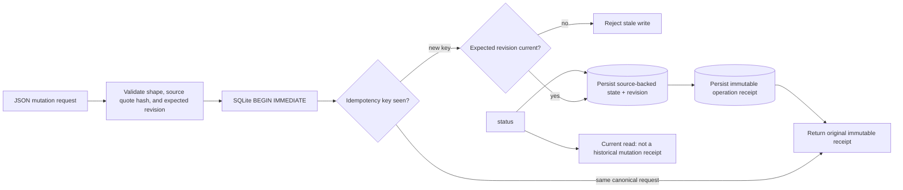

# Architecture

The source object is retained with each state revision. A write carries a caller-supplied `expected_revision`; the store serializes writers with SQLite and rejects a write based on a state snapshot that has since changed. A repeated request returns its first receipt exactly, while `status` performs a new database read.

`review` additionally requires the reviewer identity string to differ from the recorded owner. That is a small separation-of-duties control, not user authentication or an access-control system.
