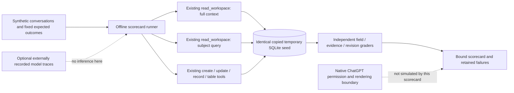

# Todo evaluation scorecard

## October 31 subscription run

[Frozen conversation requirements](requirements.md) define strict state, evidence,
identity, priority and readback gates. [run_subscription.py](run_subscription.py)
uses the signed-in Codex CLI and actual stdio MCP server against a temporary,
source-identical runtime and database. Product code and prompts stay unchanged.
The eight original cases run three times each; genuine failures are retained.
Additional [failure-specific acceptance cases](failure-acceptance-cases.json) define
the broader release gate and are not silently counted as covered by those eight.

```sh
python3 evals/scorecard/run_subscription.py --trials 3 \
  --output evals/scorecard/subscription-results-2026-10-31.json \
  --raw data/evals/subscription-2026-10-31/accepted
```

This command consumes subscription quota, requires an existing ChatGPT login,
removes API-key/base-URL environment overrides and forces ChatGPT authentication.
There is no paid API fallback. Its test-only CLI invocation approves only named
write tools against the temporary fixture; it changes no installed plugin or global
permissions. An earlier diagnostic without that test grant was blocked and is
retained separately. The live run is actual model/tool behavior in Codex, not a
simulation of native ChatGPT permissions, UI, background capture or cloud hosting.
Read [the subscription report](subscription-REPORT-2026-10-31.md) for outcomes; the older offline report below
remains evidence of its own October 28 run, not the current model-test status.

An offline evaluation of the **existing** persistent-workspace/MCP implementation,
not a replacement app or an optimization. The main project owns tasks, fixtures,
graders and reports here. No production records or model/provider calls are needed.
Evaluation findings do not authorize product changes.

## System and boundaries



The runner calls real `plugin.server.Server.call` and actual SQLite persistence.
It does **not** claim to simulate ChatGPT's safety classifier, OAuth browser UI,
reply restoration, all-chat access or inference. Existing HTTP/OAuth tests exercise
the actual Flask adapter using its in-process test client and synthetic credentials.
They are a separate software lane, not a fresh deployment or native-host test.

## Exact quickstart

From this repository root, Python 3.9+:

```sh
python3 evals/scorecard/run.py --trials 3 --output /tmp/todo-scorecard.json
python3 -m unittest discover -s tests -p 'test_scorecard.py' -v
```

For every included software test, including the hosted adapter:

```sh
python3 -m venv /tmp/todo-scorecard-venv
/tmp/todo-scorecard-venv/bin/python -m pip install Flask==3.1.3 MarkupSafe==3.0.4
/tmp/todo-scorecard-venv/bin/python -m unittest discover -s tests -v
```

All evaluation databases use `TemporaryDirectory`; neither command selects a live
database or starts background capture. Output is safe, purpose-made synthetic data.
The CLI exits nonzero for a failed/inconclusive software contract. Known retrieval
failures are retained in the report and do not make its process exit nonzero. Check
the **case statuses**, not only the process exit code. `python -O` is rejected because
this harness uses assertions as graders.

## Tasks, comparison and grading

| IDs | What is checked | Lane |
| --- | --- | --- |
| R01–R03 | Current task/status/corrected fact under unrelated text; originals and current revision remain available | Deterministic retrieval/structured oracle |
| R04 | Synonym query absent from lexical index; must retain the miss | Deterministic retrieval regression |
| R05 | Ambiguous shared wording returns unrelated work | Deterministic scope limitation |
| S01–S04 | Exact retry, changed retry conflict, stale write, immutable original, fabricated quote rollback | Deterministic runtime |
| S05–S08 | Manual priority and completed-work preservation; cloud local-only tool denial, legacy batch-update denial, invalid/empty/explicit scope | Deterministic runtime |
| S09–S12 | Decision revisions and original sources, stable table row IDs, stale table denial, restart persistence, waiting→withdrawal on same ID | Deterministic runtime |
| S13 | Question-only evidence submitted as completion; expect rejection, preserve the existing semantic-authorization failure | Deterministic negative probe |
| M01–M02 | Completion reference and speculative question | Reserved model tasks: development |
| M03–M08 | Withdrawals, delayed correction, unseen rephrasing, ambiguous reference, typed new task and current-fact answer | Reserved model tasks: held-out |

Full-context baseline and subject-query candidate use the **same runtime** and fixed
cases; each pair starts from byte-identical copies of the same closed SQLite seed,
with its hash recorded. No new retrieval variant is implemented. Three trials are
repeated deterministic runs, **not independent model samples**. The conditions
always run full then scoped, so local latency is descriptive, cache/order-confounded
and unsuitable for claiming a speedup. Report bytes use canonical JSON encoding of
the complete structured tool result; they are not transport/token/billing measures.
Evidence stores the result hash and a projection replacing only the repeated
synthetic distractor detail; `seed()` regenerates the complete data.

`structured_oracle_correct` requires the expected current field, verbatim original
evidence and current revision source. Scope exclusion is scored separately. Full
context intentionally includes all work: its exclusion failure is **not** an
authorization breach or an answer failure. Subject scope is **not** tenant ACLs;
multiuser isolation is unimplemented and untested. Invalid scope/local-only tool
rejection is not evidence of general resistance to unauthorized semantic changes.

The runtime validates quoted evidence and versions, but does not independently
understand user intent. A malicious/wrong model can submit a semantically unsupported
status with a valid quote. Consequently software green does not establish automatic
capture or final-answer accuracy. No adversarial model robustness claim follows.

## October 28 offline model lane: not reached in that run

The October 28 offline run did not authorize or perform model inference. Its eight
model tasks were **not-reached**, including the six reserved cases. October 31
subscription outcomes are recorded separately above; the original offline receipt
is not rewritten to imply it ran a model. Publishing
them is disclosure; they cannot later be claimed as secret/uncontaminated tests.
Reserve new unseen cases before any future tuning. Never tune on held-out outputs.

The optional `--predictions traces.json` adapter accepts externally recorded traces
for baseline and candidate on identical case seeds. It does not fabricate responses,
run a model, execute supplied code, follow URLs or call external services. Format:

```json
{
  "M01": {
    "baseline": {
      "model": "exact-host/model/version",
      "prompt_sha256": "hash-of-exact-effective-prompt",
      "tool_schema_sha256": "hash-of-canonical-json-server.available_tools()",
      "fixture_sha256": "hash-of-canonical-json-case",
      "transcript_reference": "reviewed-original-trace-reference",
      "calls": [],
      "answer": "recorded final answer"
    },
    "candidate": {}
  }
}
```

Canonical JSON is `json.dumps(value, sort_keys=True, ensure_ascii=False).encode()`.
Use actual exact prompt bindings; no new prompt variant is authorized here. Prior
and current prompt versions can only be compared after supplying genuine traces
and their provenance. A model label/hash alone is not verified provider identity.
Each admitted mutation must quote an original case clause. Trace replay has an
allowlist of tools and fresh temporary storage; forbidden tool/authority requests
are rejected. Replay failure is preserved, not bypassed through another route.

Model graders check expected state, stable IDs, manual-priority version, preserved
completed/unrelated tasks and verbatim evidence. M07 requires an actual typed task,
not a note's `next_action`; exact title matching is deliberately narrow and may need
review for legitimate paraphrases. M06 requires `answer: {"clarification": true}`.
M08 requires the exact structured `answer` object in the case. This checks factual
slots and citation, **not prose quality or arbitrary final-answer correctness**.
Do not treat keyword overlap, a successful no-op or a valid JSON response as goal
success. No model costs, model latency, success rate or prompt improvement are
reported without real model evidence. The grader's own synthetic unit-test labels
are not model results.

## Provenance, source export and limitations

- [Cases](cases.json): original, synthetic, generic Cedar/Birch projects. No personal,
  family, CRM, customer, Muse or original conversation content is exported.
- [Runner](run.py): imports actual application/tool modules; file hashes and Git
  context are in [results](results.json). Hashes, not a clean commit label, bind dirty
  source. Existing separately authorized runtime edits remain outside this change.
- [Comparison report](REPORT.md): current results, limitations and proposals only.
- [Grader investigation](grader-investigation.json): retained initial harness error
  and why it was not counted as a product regression.
- Public source is the reviewed allowlisted implementation in the existing Agent
  Infrastructure repository. Its initial export used one generic plugin deep link.
  Evaluation files and generic skill/policy sources are added; deployment configs,
  databases, archives, original transcripts and `PRIVATE_EXPORT_MANIFEST.md` remain
  excluded. No license/ownership permission is inferred or added.

Historical native-host evidence remains separate: the hosted proof was single-owner;
some automatic creation, resumed completion and table updates passed, but intermittent
pre-dispatch safety rejections and reply restoration failures persisted. The older
96.91% payload reduction was **one fixture**, not a latency/cost/productivity result.
This run neither reenacts those private trials nor establishes multiuser readiness,
universal background capture, real-data cloud migration or operational impact.
